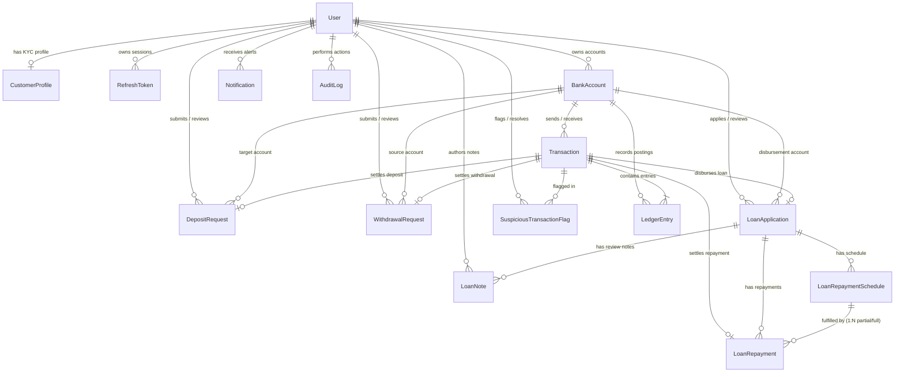

# VaultEdge — Database Schema & Data Integrity Specification

> **Purpose**: This document defines the complete, normalized PostgreSQL & Prisma relational database blueprint for **VaultEdge**. It establishes every model, enum, field, relation, constraint, index, deletion policy, and financial consistency rule implemented in `prisma/schema.prisma` and migrated to PostgreSQL via `prisma/migrations/20261122174249_init_vaultedge/migration.sql`.

---

## Table of Contents
1. [Architectural Model Evaluation & Consolidation Decisions](#1-architectural-model-evaluation--consolidation-decisions)
2. [Financial Data Integrity & Balance Storage Strategy](#2-financial-data-integrity--balance-storage-strategy)
3. [Entity-Relationship Diagram (Mermaid ERD)](#3-entity-relationship-diagram-mermaid-erd)
4. [Required Enums](#4-required-enums)
5. [Detailed Model Specifications](#5-detailed-model-specifications)
   - [5.1 `User` (Authentication, RBAC & Transaction PIN)](#51-user-authentication-rbac--transaction-pin)
   - [5.2 `RefreshToken` (JWT Session & Token Rotation)](#52-refreshtoken-jwt-session--token-rotation)
   - [5.3 `CustomerProfile` (KYC & Verification Records)](#53-customerprofile-kyc--verification-records)
   - [5.4 `BankAccount` (Accounts, Balances & Per-Account Limits)](#54-bankaccount-accounts-balances--per-account-limits)
   - [5.5 `Transaction` (Immutable Financial Header)](#55-transaction-immutable-financial-header)
   - [5.6 `LedgerEntry` (Immutable Double-Entry Account Postings)](#56-ledgerentry-immutable-double-entry-account-postings)
   - [5.7 `DepositRequest` (Customer Deposit Approval Workflow)](#57-depositrequest-customer-deposit-approval-workflow)
   - [5.8 `WithdrawalRequest` (Customer Withdrawal Approval Workflow)](#58-withdrawalrequest-customer-withdrawal-approval-workflow)
   - [5.9 `LoanApplication` (Customer Loan Application & Staff/Admin Review)](#59-loanapplication-customer-loan-application--staffadmin-review)
   - [5.10 `LoanNote` (Internal Bank Staff & Admin Review Notes)](#510-loannote-internal-bank-staff--admin-review-notes)
   - [5.11 `LoanRepaymentSchedule` (Installment Schedule)](#511-loanrepaymentschedule-installment-schedule)
   - [5.12 `LoanRepayment` (Recorded Loan Repayment Transactions)](#512-loanrepayment-recorded-loan-repayment-transactions)
   - [5.13 `SuspiciousTransactionFlag` (Staff & Rule-Based Flagging)](#513-suspicioustransactionflag-staff--rule-based-flagging)
   - [5.14 `Notification` (Customer Event Alerts)](#514-notification-customer-event-alerts)
   - [5.15 `SystemSetting` (Bank-Wide Financial Limits & Defaults)](#515-systemsetting-bank-wide-financial-limits--defaults)
   - [5.16 `AuditLog` (Administrative & Sensitive Action Trail)](#516-auditlog-administrative--sensitive-action-trail)
6. [Relationship Summary Matrix](#6-relationship-summary-matrix)
7. [Constraints, Indexes & Financial Retention Rules](#7-constraints-indexes--financial-retention-rules)

---

## 1. Architectural Model Evaluation & Consolidation Decisions

To avoid redundant tables and overlapping responsibilities, each candidate model group was evaluated against `docs/REQUIREMENTS.md`:

| Candidate Model Group | Architectural Decision | Rationale |
| :--- | :--- | :--- |
| **`User` + `CustomerProfile` + `AccountVerification`** | **Consolidated into `User` + `CustomerProfile`** | `User` holds universal credentials, role (`ADMIN`, `STAFF`, `CUSTOMER`), status (`ACTIVE`, `DEACTIVATED`, `BLOCKED`), and security fields. `CustomerProfile` (`1:1` with `User`) stores KYC details (phone, address, national ID, employment, monthly income) and verification metadata (`kycStatus`, `verifiedById`, `verifiedAt`). Creating a separate `AccountVerification` table is unnecessary unless multiple historical KYC document uploads are required; audit history is already captured in `AuditLog`. |
| **`TransactionPin`** | **Embedded on `User` (`transactionPinHash`, `pinFailedAttempts`, `pinLockedUntil`)** | A Transaction PIN is strictly `1:1` with an authenticated user. Embedding the bcrypt/argon2 hash and lockout counters directly on `User` avoids an extra join on every transfer while keeping the hash strictly server-only. |
| **`RefreshToken` / `Session`** | **Included as `RefreshToken`** | Supports stateful revocation, device/session tracking, and immediate session termination when an Admin deactivates or blocks a suspicious customer account. |
| **`BankAccount` + Account Limits** | **Included as `BankAccount` with per-account limit columns + `SystemSetting` for global defaults** | `docs/REQUIREMENTS.md` requires Admin to *"Set account transaction limits"* per account (§2.1) and configure bank-wide *"Daily transfer limit, Maximum single transaction amount, Minimum account balance"* (§5.3). Storing nullable override columns (`dailyTransferLimit`, `maxSingleTransactionLimit`, `minBalanceRequired`) on `BankAccount` alongside global defaults in `SystemSetting` satisfies both requirements cleanly without an extra join table. |
| **`Transaction` + `LedgerEntry` (Double-Entry Evaluation)** | **Included Both (`Transaction` header + `LedgerEntry` postings)** | `docs/REQUIREMENTS.md` (§2.3 & §3.2) requires: *"Every transaction should contain Transaction ID, Sender Account, Receiver Account (if applicable), Transaction Type, Amount, Transaction Fee, Transaction Date, Transaction Status, Description"* AND *"Both sender and receiver should receive corresponding transaction records."* Using `Transaction` as the canonical event header (`referenceId`, `senderAccountId`, `receiverAccountId`, `amount`, `fee`) paired with two immutable `LedgerEntry` rows (`DEBIT` for sender, `CREDIT` for receiver, each storing `balanceBefore` and `balanceAfter`) provides true banking double-entry auditability and fast per-account statement queries. |
| **`DepositRequest` & `WithdrawalRequest`** | **Kept as two explicit models (`DepositRequest`, `WithdrawalRequest`)** | Matches the separate route structure (`/admin/deposits`, `/admin/withdrawals`, `/customer/deposit-requests`, `/customer/withdrawal-requests`) and links directly to the resulting `Transaction` (`transactionId`) once approved. |
| **`LoanApplication` vs. `Loan` + `LoanNote` + `LoanRepaymentSchedule` + `LoanRepayment`** | **Consolidated `LoanApplication` & `Loan` into `LoanApplication` (with lifecycle fields), plus `LoanNote`, `LoanRepaymentSchedule`, and `LoanRepayment`** | In `docs/REQUIREMENTS.md` (§3.3), a loan progresses linearly through `Pending` → `Under Review` → `Approved` / `Rejected` → `Active` → `Completed`. Splitting `LoanApplication` and `Loan` into two 1:1 tables duplicates status and amount fields. Keeping a single `LoanApplication` (or `Loan`) entity that records application inputs, staff/admin review actors, disbursement transaction link, and `remainingBalance`—paired with `LoanNote` (`1:N`), `LoanRepaymentSchedule` (`1:N`), and `LoanRepayment` (`1:N`)—eliminates synchronization bugs. |
| **`SuspiciousTransactionFlag`** | **Included as `SuspiciousTransactionFlag`** | Supports Bank Staff flagging suspicious transactions for Admin review (§2.2) AND Bonus Challenge #6 (*Rule-based Suspicious Transaction Detection* §5.6), tracking flag source (`STAFF_MANUAL` vs. `SYSTEM_RULE`), reason, status, and Admin resolution. |
| **`Notification` & `AuditLog`** | **Included Both** | `Notification` powers customer alerts (§5.2: money received, transfer completed, deposit approved, withdrawal rejected, loan approved/rejected). `AuditLog` records privileged Staff/Admin actions (account freeze, customer block, limit change, loan decision). |

---

## 2. Financial Data Integrity & Balance Storage Strategy

### 2.1 Cached Account Balance + Immutable Ledger Strategy
- **Decision**: `BankAccount` stores an authoritative **cached `balance` (`Decimal(18, 2)`)** column, while every balance mutation simultaneously writes an immutable **`LedgerEntry`** row containing `direction` (`DEBIT` or `CREDIT`), `amount`, `balanceBefore`, and `balanceAfter`.
- **Why Both Are Required**:
  1. **Real-Time Validation & Performance**: Dashboard KPIs (*Total Bank Balance*, *Available Balance*) and pre-transfer balance checks require instant `O(1)` reads without summing millions of historical ledger rows on every request.
  2. **Cryptographic-Grade Auditability**: Every `LedgerEntry` records the exact `balanceBefore` and `balanceAfter` at the moment of execution inside `prisma.$transaction`. At any point, `BankAccount.balance` must equal the `balanceAfter` of the latest `LedgerEntry` for that account, and must equal `SUM(CREDIT) - SUM(DEBIT)`.

### 2.2 PostgreSQL Decimal Precision Rule
- **Mandatory Type**: All monetary columns across the entire database use PostgreSQL **`DECIMAL(18, 2)`** (`@db.Decimal(18, 2)` in Prisma).
- **Zero Floating-Point Rule**: `Float` / `DoublePrecision` are strictly forbidden for balances, amounts, fees, incomes, or limits to prevent IEEE-754 rounding discrepancies.
- **Interest Rates**: Stored as `DECIMAL(5, 2)` (e.g., `8.50` for `8.50%` annual rate).

### 2.3 Atomic Transaction Consistency Rules (`prisma.$transaction`)
1. **Fund Transfer (`FUND_TRANSFER`)**:
   - Verify idempotency key (`idempotencyKey`) does not already exist.
   - Verify authenticated customer owns `senderAccountId` and validate `User.transactionPinHash`.
   - Lock/read `senderAccount` and `receiverAccount` inside `prisma.$transaction`.
   - Confirm both accounts have `status == ACTIVE` and their owners are `ACTIVE`.
   - Confirm `amount > 0`, `amount <= effectiveMaxSingleLimit`, today's cumulative outgoing transfers + `amount <= effectiveDailyLimit`, and `senderAccount.balance - (amount + fee) >= effectiveMinBalance`.
   - Decrement `senderAccount.balance` by `amount + fee`; increment `receiverAccount.balance` by `amount`.
   - Create one `Transaction` record (`status: COMPLETED`, unique `referenceId`).
   - Create two `LedgerEntry` records:
     - Sender `LedgerEntry`: `direction: DEBIT`, `amount: amount + fee`, `balanceBefore`, `balanceAfter`.
     - Receiver `LedgerEntry`: `direction: CREDIT`, `amount: amount`, `balanceBefore`, `balanceAfter`.
   - Emit `Notification` records for sender (*Transfer Completed*) and receiver (*Money Received*).
   - If any step fails, PostgreSQL rolls back the entire transaction so money is **never** deducted from only one account.
2. **Deposit Approval (`DEPOSIT`)**:
   - Inside `prisma.$transaction`: transition `DepositRequest.status` from `PENDING` to `APPROVED`, decrement the internal bank treasury account (`BankAccount.isSystemAccount == true`, `accountType == INTERNAL_TREASURY`) and increment the customer's `BankAccount.balance` by `amount`, create `Transaction` (`type: DEPOSIT`, `status: COMPLETED`, `senderAccountId: treasuryAccount.id`, `receiverAccountId: customerAccount.id`) + two balanced `LedgerEntry` rows (`DEBIT` on treasury, `CREDIT` on customer account), link `transactionId`, and create customer `Notification`.
3. **Withdrawal Approval (`WITHDRAWAL`)**:
   - Inside `prisma.$transaction`: re-verify `BankAccount.balance - amount >= effectiveMinBalance`, transition `WithdrawalRequest.status` from `PENDING` to `APPROVED`, decrement customer `BankAccount.balance` and increment the internal bank treasury account, create `Transaction` (`type: WITHDRAWAL`, `status: COMPLETED`, `senderAccountId: customerAccount.id`, `receiverAccountId: treasuryAccount.id`) + two balanced `LedgerEntry` rows (`DEBIT` on customer account, `CREDIT` on treasury), link `transactionId`, and create customer `Notification`.
4. **Loan Approval & Disbursement (`LOAN_DISBURSEMENT`)**:
   - Inside `prisma.$transaction`: transition `LoanApplication.status` to `ACTIVE` (after approval), decrement the internal bank treasury account and increment target `disbursementAccount.balance` by `requestedAmount`, create `Transaction` (`type: LOAN_DISBURSEMENT`, `status: COMPLETED`, `senderAccountId: treasuryAccount.id`, `receiverAccountId: disbursementAccount.id`) + two balanced `LedgerEntry` rows (`DEBIT` on treasury, `CREDIT` on customer account), generate `LoanRepaymentSchedule` installments, and notify the customer.

---

## 3. Entity-Relationship Diagram (Mermaid ERD)

---

## 4. Required Enums

| Enum Name | Allowed Values | Purpose |
| :--- | :--- | :--- |
| **`UserRole`** | `ADMIN`, `STAFF`, `CUSTOMER` | Enforces 3-tier role-based access control (§3.1). |
| **`UserStatus`** | `ACTIVE`, `DEACTIVATED`, `BLOCKED` | Admin customer activation, deactivation, and blocking of suspicious accounts (§2.1). |
| **`KycVerificationStatus`** | `PENDING`, `VERIFIED`, `REJECTED` | Bank Staff customer verification workflow (§2.2). |
| **`EmploymentStatus`** | `EMPLOYED`, `SELF_EMPLOYED`, `BUSINESS_OWNER`, `STUDENT`, `RETIRED`, `UNEMPLOYED` | Customer employment classification for KYC & loan applications (§3.3). |
| **`AccountType`** | `SAVINGS`, `CURRENT`, `BUSINESS`, `INTERNAL_TREASURY` | Required customer bank account types (§2.3) plus internal bank treasury/clearing accounts for balanced double-entry deposits, withdrawals, loans, and fee collection. |
| **`AccountStatus`** | `ACTIVE`, `FROZEN`, `INACTIVE`, `BLOCKED` | Supports Admin account freeze/unfreeze and status checks (§2.1, §2.3). |
| **`TransactionType`** | `DEPOSIT`, `WITHDRAWAL`, `FUND_TRANSFER`, `LOAN_DISBURSEMENT`, `LOAN_REPAYMENT` | All 5 required banking transaction types (§3.2). |
| **`TransactionStatus`** | `PENDING`, `COMPLETED`, `FAILED`, `REVERSED` | All 4 required transaction statuses (§3.2). |
| **`LedgerDirection`** | `DEBIT`, `CREDIT` | Distinguishes outgoing vs. incoming account ledger postings. |
| **`LedgerEntryCategory`** | `PRINCIPAL`, `FEE`, `INTEREST`, `REVERSAL` | Distinguishes principal postings from separate fee, loan interest, or reversal postings on the same transaction and account. |
| **`RequestStatus`** | `PENDING`, `APPROVED`, `REJECTED` | Required statuses for Deposit and Withdrawal requests (§2.3). |
| **`LoanType`** | `PERSONAL`, `HOME`, `AUTO`, `BUSINESS`, `EDUCATION` | Categorizes customer loan applications (§3.3). |
| **`LoanStatus`** | `PENDING`, `UNDER_REVIEW`, `APPROVED`, `REJECTED`, `ACTIVE`, `COMPLETED` | All 6 required loan lifecycle statuses (§3.3). |
| **`InstallmentStatus`** | `PENDING`, `PARTIALLY_PAID`, `PAID`, `OVERDUE` | Tracks individual repayment schedule installments, including partial payments (§3.3). |
| **`FlagSource`** | `STAFF_MANUAL`, `SYSTEM_RULE` | Distinguishes staff manual flags (§2.2) from automated rule detection (§5.6). |
| **`FlagStatus`** | `OPEN`, `UNDER_REVIEW`, `RESOLVED_SAFE`, `CONFIRMED_SUSPICIOUS` | Admin review lifecycle for flagged transactions. |
| **`NotificationType`** | `MONEY_RECEIVED`, `TRANSFER_COMPLETED`, `DEPOSIT_APPROVED`, `DEPOSIT_REJECTED`, `WITHDRAWAL_APPROVED`, `WITHDRAWAL_REJECTED`, `LOAN_APPROVED`, `LOAN_REJECTED`, `ACCOUNT_STATUS_CHANGED`, `SECURITY_ALERT` | Covers all required customer notification triggers (§5.2). |

---

## 5. Detailed Model Specifications

### 5.1 `User` (Authentication, RBAC & Transaction PIN)
- **Purpose**: Core identity, authentication credentials, RBAC role, account status, 2FA flag, and server-side hashed Transaction PIN.
- **Primary Key**: `id` (`String @id @default(cuid())`)
- **Important Fields**:
  - `email`: `String @unique` — Login identifier.
  - `passwordHash`: `String` — Hashed login password.
  - `firstName`, `lastName`: `String` — Full legal name.
  - `role`: `UserRole @default(CUSTOMER)` — `ADMIN`, `STAFF`, or `CUSTOMER`.
  - `status`: `UserStatus @default(ACTIVE)` — `ACTIVE`, `DEACTIVATED`, or `BLOCKED`.
  - `transactionPinHash`: `String?` — Hashed 4- or 6-digit Transaction PIN for fund transfers.
  - `pinFailedAttempts`: `Int @default(0)` — Brute-force protection counter.
  - `pinLockedUntil`: `DateTime?` — Temporary lockout timestamp after repeated invalid PIN attempts.
  - `twoFactorEnabled`: `Boolean @default(false)` — Supports Bonus Challenge #5 (2FA).
  - `twoFactorSecret`: `String?` — Encrypted TOTP/verification secret when 2FA is active.
  - `lastLoginAt`: `DateTime?`
  - `createdAt`, `updatedAt`: `DateTime`

### 5.2 `RefreshToken` (JWT Session & Token Rotation)
- **Purpose**: Manages active refresh tokens for Custom JWT Authentication, enabling instant revocation on logout or when an Admin blocks a user.
- **Primary Key**: `id` (`String @id @default(cuid())`)
- **Foreign Keys**: `userId` → `User.id` (`onDelete: Cascade`)
- **Important Fields**:
  - `tokenHash`: `String @unique` — SHA-256 hash of the refresh token.
  - `userAgent`, `ipAddress`: `String?`
  - `expiresAt`: `DateTime`
  - `revokedAt`: `DateTime?`
  - `createdAt`: `DateTime @default(now())`

### 5.3 `CustomerProfile` (KYC & Verification Records)
- **Purpose**: Stores customer-specific demographic, KYC, and employment details verified by Bank Staff.
- **Primary Key**: `id` (`String @id @default(cuid())`)
- **Foreign Keys**:
  - `userId`: `String @unique` → `User.id` (`1:1`, `onDelete: Restrict` — preserves KYC audit trail)
  - `verifiedById`: `String?` → `User.id` (`onDelete: SetNull`) — Staff/Admin who verified the customer.
- **Important Fields**:
  - `customerCode`: `String @unique` — Human-readable customer ID (e.g., `CUS-2026-0001`).
  - `phone`: `String @unique`
  - `dateOfBirth`: `DateTime?`
  - `addressLine1`, `city`, `state`, `postalCode`, `country`: `String?`
  - `nationalIdNumber`: `String? @unique` — Government ID / KYC reference.
  - `employmentStatus`: `EmploymentStatus @default(EMPLOYED)`
  - `monthlyIncome`: `Decimal @default(0.00) @db.Decimal(18, 2)`
  - `kycStatus`: `KycVerificationStatus @default(PENDING)`
  - `kycNotes`: `String?`
  - `verifiedAt`: `DateTime?`
  - `createdAt`, `updatedAt`: `DateTime`

### 5.4 `BankAccount` (Accounts, Balances & Per-Account Limits)
- **Purpose**: Represents a customer's `SAVINGS`, `CURRENT`, or `BUSINESS` account (or an institution-owned `INTERNAL_TREASURY` system account), its authoritative cached balance, freeze/status controls, and per-account transaction limit overrides.
- **Primary Key**: `id` (`String @id @default(cuid())`)
- **Foreign Keys**:
  - `userId`: `String?` → `User.id` (`onDelete: Restrict` — nullable only for bank-owned `INTERNAL_TREASURY` system accounts where `isSystemAccount == true`; required for all customer accounts).
  - `createdById`: `String?` → `User.id` (`onDelete: SetNull`) — Admin or Staff who opened the account.
- **Important Fields**:
  - `accountNumber`: `String @unique` — Unique 10–12 digit formatted bank account number (e.g., `1020004821`).
  - `accountTitle`: `String` — Display title / holder name.
  - `accountType`: `AccountType` — `SAVINGS`, `CURRENT`, `BUSINESS`, or `INTERNAL_TREASURY`.
  - `status`: `AccountStatus @default(ACTIVE)` — `ACTIVE`, `FROZEN`, `INACTIVE`, `BLOCKED`.
  - `isSystemAccount`: `Boolean @default(false)` — Identifies internal bank treasury/clearing accounts used as the counterparty for double-entry deposits, withdrawals, loan disbursements, loan repayments, and fee settlements (excluded from customer-facing account lists).
  - `currency`: `String @default("USD")`
  - `balance`: `Decimal @default(0.00) @db.Decimal(18, 2)` — Current available account balance.
  - `dailyTransferLimit`: `Decimal? @db.Decimal(18, 2)` — Per-account daily transfer limit override (falls back to `SystemSetting` if null).
  - `maxSingleTransactionLimit`: `Decimal? @db.Decimal(18, 2)` — Per-account single transfer limit override.
  - `minBalanceRequired`: `Decimal? @db.Decimal(18, 2)` — Per-account minimum balance floor override.
  - `frozenReason`: `String?`
  - `frozenAt`: `DateTime?`
  - `createdAt`, `updatedAt`: `DateTime`

### 5.5 `Transaction` (Immutable Financial Header)
- **Purpose**: Canonical record of every financial event (`DEPOSIT`, `WITHDRAWAL`, `FUND_TRANSFER`, `LOAN_DISBURSEMENT`, `LOAN_REPAYMENT`) with unique Transaction Reference ID and duplicate prevention key.
- **Primary Key**: `id` (`String @id @default(cuid())`)
- **Foreign Keys**:
  - `senderAccountId`: `String?` → `BankAccount.id` (`onDelete: Restrict`) — Populated for `WITHDRAWAL`, `FUND_TRANSFER`, `LOAN_REPAYMENT` (and internal treasury account for `DEPOSIT` / `LOAN_DISBURSEMENT`).
  - `receiverAccountId`: `String?` → `BankAccount.id` (`onDelete: Restrict`) — Populated for `DEPOSIT`, `FUND_TRANSFER`, `LOAN_DISBURSEMENT` (and internal treasury account for `WITHDRAWAL` / `LOAN_REPAYMENT`).
  - `initiatedById`: `String` → `User.id` (`onDelete: Restrict`)
  - `reversedTransactionId`: `String? @unique` → `Transaction.id` (`onDelete: Restrict`) — Self-relation linking a compensating reversal transaction to the original `REVERSED` transaction.
- **Important Fields**:
  - `referenceId`: `String @unique` — Public unique Transaction ID required for search and receipts (e.g., `TXN-20261122-8F4A9C`).
  - `idempotencyKey`: `String? @unique` — Prevents duplicate transaction submissions on retries.
  - `type`: `TransactionType`
  - `status`: `TransactionStatus @default(PENDING)` — `PENDING`, `COMPLETED`, `FAILED`, `REVERSED`.
  - `amount`: `Decimal @db.Decimal(18, 2)` — Principal transaction amount (`> 0`).
  - `fee`: `Decimal @default(0.00) @db.Decimal(18, 2)` — Transaction fee charged.
  - `totalAmount`: `Decimal @db.Decimal(18, 2)` — `amount + fee`.
  - `description`: `String?`
  - `failureReason`: `String?`
  - `isFlagged`: `Boolean @default(false)` — Quick filter flag when suspicious activity is detected.
  - `executedAt`: `DateTime @default(now())`
  - `createdAt`: `DateTime @default(now())`

### 5.6 `LedgerEntry` (Immutable Double-Entry Account Postings)
- **Purpose**: Ensures every account involved in a transaction has its own immutable `DEBIT` or `CREDIT` statement line with exact pre- and post-transaction balance snapshots.
- **Primary Key**: `id` (`String @id @default(cuid())`)
- **Foreign Keys**:
  - `transactionId`: `String` → `Transaction.id` (`onDelete: Restrict`)
  - `accountId`: `String` → `BankAccount.id` (`onDelete: Restrict`)
- **Important Fields**:
  - `direction`: `LedgerDirection` — `DEBIT` or `CREDIT`.
  - `entryCategory`: `LedgerEntryCategory @default(PRINCIPAL)` — `PRINCIPAL`, `FEE`, `INTEREST`, or `REVERSAL`. Allows separate principal and fee/interest postings on the same account within a single transaction.
  - `amount`: `Decimal @db.Decimal(18, 2)`
  - `balanceBefore`: `Decimal @db.Decimal(18, 2)`
  - `balanceAfter`: `Decimal @db.Decimal(18, 2)`
  - `description`: `String?`
  - `createdAt`: `DateTime @default(now())`
- **Unique Constraint**: `@@unique([transactionId, accountId, direction, entryCategory])`

### 5.7 `DepositRequest` (Customer Deposit Approval Workflow)
- **Purpose**: Tracks customer deposit requests through `PENDING`, `APPROVED`, or `REJECTED` states (§2.3).
- **Primary Key**: `id` (`String @id @default(cuid())`)
- **Foreign Keys**:
  - `accountId`: `String` → `BankAccount.id` (`onDelete: Restrict`)
  - `customerId`: `String` → `User.id` (`onDelete: Restrict`)
  - `reviewedById`: `String?` → `User.id` (`onDelete: SetNull`)
  - `transactionId`: `String? @unique` → `Transaction.id` (`onDelete: Restrict`) — Populated when approved.
- **Important Fields**:
  - `requestReference`: `String @unique` (e.g., `DEP-2026-00412`)
  - `idempotencyKey`: `String? @unique` — Prevents duplicate deposit request submissions on network retry.
  - `amount`: `Decimal @db.Decimal(18, 2)`
  - `description`: `String?`
  - `status`: `RequestStatus @default(PENDING)`
  - `reviewNote`: `String?`
  - `requestedAt`: `DateTime @default(now())`
  - `reviewedAt`: `DateTime?`

### 5.8 `WithdrawalRequest` (Customer Withdrawal Approval Workflow)
- **Purpose**: Tracks customer withdrawal requests through `PENDING`, `APPROVED`, or `REJECTED` states (§2.3).
- **Primary Key**: `id` (`String @id @default(cuid())`)
- **Foreign Keys**:
  - `accountId`: `String` → `BankAccount.id` (`onDelete: Restrict`)
  - `customerId`: `String` → `User.id` (`onDelete: Restrict`)
  - `reviewedById`: `String?` → `User.id` (`onDelete: SetNull`)
  - `transactionId`: `String? @unique` → `Transaction.id` (`onDelete: Restrict`) — Populated when approved.
- **Important Fields**:
  - `requestReference`: `String @unique` (e.g., `WDR-2026-00198`)
  - `idempotencyKey`: `String? @unique` — Prevents duplicate withdrawal request submissions on network retry.
  - `amount`: `Decimal @db.Decimal(18, 2)`
  - `description`: `String?`
  - `status`: `RequestStatus @default(PENDING)`
  - `reviewNote`: `String?`
  - `requestedAt`: `DateTime @default(now())`
  - `reviewedAt`: `DateTime?`

### 5.9 `LoanApplication` (Customer Loan Application & Staff/Admin Review)
- **Purpose**: Manages the complete loan lifecycle from customer application (`PENDING`), Bank Staff review & forwarding (`UNDER_REVIEW`), Admin decision (`APPROVED` / `REJECTED`), disbursement (`ACTIVE`), to full payoff (`COMPLETED`) (§2.1, §2.2, §3.3).
- **Primary Key**: `id` (`String @id @default(cuid())`)
- **Foreign Keys**:
  - `customerId`: `String` → `User.id` (`onDelete: Restrict`)
  - `disbursementAccountId`: `String` → `BankAccount.id` (`onDelete: Restrict`) — Customer account receiving the disbursed funds.
  - `reviewedByStaffId`: `String?` → `User.id` (`onDelete: SetNull`) — Bank Staff who reviewed and forwarded the application.
  - `decidedByAdminId`: `String?` → `User.id` (`onDelete: SetNull`) — Admin who approved or rejected the loan.
  - `disbursementTransactionId`: `String? @unique` → `Transaction.id` (`onDelete: Restrict`) — Links to the `LOAN_DISBURSEMENT` transaction.
- **Important Fields**:
  - `loanReference`: `String @unique` (e.g., `LN-2026-00084`)
  - `idempotencyKey`: `String? @unique` — Prevents duplicate loan application submissions on retry.
  - `loanType`: `LoanType`
  - `requestedAmount`: `Decimal @db.Decimal(18, 2)`
  - `approvedAmount`: `Decimal? @db.Decimal(18, 2)` — Authoritative principal approved and disbursed by Admin.
  - `interestRate`: `Decimal @default(8.50) @db.Decimal(5, 2)` — Annual interest percentage applied upon approval.
  - `durationMonths`: `Int` — Loan duration in months.
  - `monthlyIncome`: `Decimal @db.Decimal(18, 2)` — Snapshot of applicant's monthly income.
  - `employmentStatus`: `EmploymentStatus`
  - `description`: `String` — Application description / purpose.
  - `status`: `LoanStatus @default(PENDING)`
  - `totalPayableAmount`: `Decimal? @db.Decimal(18, 2)` — Calculated principal + interest once approved.
  - `monthlyInstallment`: `Decimal? @db.Decimal(18, 2)`
  - `totalRepaidAmount`: `Decimal @default(0.00) @db.Decimal(18, 2)` — Cumulative repayments received (`totalRepaidAmount + remainingBalance == totalPayableAmount`).
  - `remainingBalance`: `Decimal @default(0.00) @db.Decimal(18, 2)` — Tracked remaining balance as repayments occur.
  - `rejectionReason`: `String?`
  - `forwardedForApprovalAt`: `DateTime?`
  - `decidedAt`, `disbursedAt`, `completedAt`: `DateTime?`
  - `createdAt`, `updatedAt`: `DateTime`

### 5.10 `LoanNote` (Internal Bank Staff & Admin Review Notes)
- **Purpose**: Allows Bank Staff to attach internal review notes to a loan application before forwarding it for Admin approval (§2.2).
- **Primary Key**: `id` (`String @id @default(cuid())`)
- **Foreign Keys**:
  - `loanApplicationId`: `String` → `LoanApplication.id` (`onDelete: Restrict`)
  - `authorId`: `String` → `User.id` (`onDelete: Restrict`)
- **Important Fields**:
  - `note`: `String`
  - `isInternal`: `Boolean @default(true)` — Hidden from Customer views; visible only to Staff and Admin.
  - `createdAt`: `DateTime @default(now())`

### 5.11 `LoanRepaymentSchedule` (Installment Schedule)
- **Purpose**: Stores the structured monthly repayment schedule generated when a loan is approved and disbursed (§3.3).
- **Primary Key**: `id` (`String @id @default(cuid())`)
- **Foreign Keys**: `loanApplicationId`: `String` → `LoanApplication.id` (`onDelete: Restrict`)
- **Important Fields**:
  - `installmentNumber`: `Int` (`1..durationMonths`)
  - `dueDate`: `DateTime`
  - `principalAmount`: `Decimal @db.Decimal(18, 2)`
  - `interestAmount`: `Decimal @db.Decimal(18, 2)`
  - `totalInstallment`: `Decimal @db.Decimal(18, 2)`
  - `paidAmount`: `Decimal @default(0.00) @db.Decimal(18, 2)` — Cumulative amount paid toward this installment across one or more repayments.
  - `status`: `InstallmentStatus @default(PENDING)` — `PENDING`, `PARTIALLY_PAID`, `PAID`, `OVERDUE`.
  - `paidAt`: `DateTime?`
- **Unique Constraint**: `@@unique([loanApplicationId, installmentNumber])`

### 5.12 `LoanRepayment` (Recorded Loan Repayment Transactions)
- **Purpose**: Links an actual customer repayment event to the `LoanApplication`, optional `LoanRepaymentSchedule` installment (`1:N` supporting partial payments and multiple repayments per installment), and the underlying `LOAN_REPAYMENT` banking `Transaction` (§2.1, §3.2, §3.3).
- **Primary Key**: `id` (`String @id @default(cuid())`)
- **Foreign Keys**:
  - `loanApplicationId`: `String` → `LoanApplication.id` (`onDelete: Restrict`)
  - `scheduleId`: `String?` → `LoanRepaymentSchedule.id` (`onDelete: Restrict` — non-unique `1:N` so multiple partial repayments can settle a single installment)
  - `transactionId`: `String @unique` → `Transaction.id` (`onDelete: Restrict`)
  - `paidFromAccountId`: `String` → `BankAccount.id` (`onDelete: Restrict`)
- **Important Fields**:
  - `amountPaid`: `Decimal @db.Decimal(18, 2)`
  - `principalComponent`: `Decimal @default(0.00) @db.Decimal(18, 2)`
  - `interestComponent`: `Decimal @default(0.00) @db.Decimal(18, 2)`
  - `remainingBalanceAfter`: `Decimal @db.Decimal(18, 2)`
  - `paidAt`: `DateTime @default(now())`

### 5.13 `SuspiciousTransactionFlag` (Staff & Rule-Based Flagging)
- **Purpose**: Records suspicious transaction flags raised manually by Bank Staff (§2.2) or automatically by rule-based detection (§5.6) for Admin investigation.
- **Primary Key**: `id` (`String @id @default(cuid())`)
- **Foreign Keys**:
  - `transactionId`: `String` → `Transaction.id` (`onDelete: Restrict`)
  - `flaggedById`: `String?` → `User.id` (`onDelete: SetNull`) — Null if triggered by `SYSTEM_RULE`.
  - `resolvedByAdminId`: `String?` → `User.id` (`onDelete: SetNull`)
- **Important Fields**:
  - `source`: `FlagSource` (`STAFF_MANUAL` or `SYSTEM_RULE`)
  - `ruleCode`: `String?` (e.g., `HIGH_VALUE_TRANSFER`, `RAPID_VELOCITY`)
  - `reason`: `String`
  - `status`: `FlagStatus @default(OPEN)`
  - `resolutionNote`: `String?`
  - `createdAt`: `DateTime @default(now())`
  - `resolvedAt`: `DateTime?`

### 5.14 `Notification` (Customer Event Alerts)
- **Purpose**: Stores in-app customer notifications when money is received, a transfer completes, a deposit is approved, a withdrawal is rejected, or a loan is approved/rejected (§5.2).
- **Primary Key**: `id` (`String @id @default(cuid())`)
- **Foreign Keys**: `userId`: `String` → `User.id` (`onDelete: Cascade`)
- **Important Fields**:
  - `type`: `NotificationType`
  - `title`: `String`
  - `message`: `String`
  - `referenceId`: `String?` — Related transaction/loan/request reference for deep linking.
  - `isRead`: `Boolean @default(false)`
  - `readAt`: `DateTime?`
  - `createdAt`: `DateTime @default(now())`

### 5.15 `SystemSetting` (Bank-Wide Financial Limits & Defaults)
- **Purpose**: Single-row (or keyed) bank-wide financial configuration managed exclusively by Admin (§2.2, §5.3).
- **Primary Key**: `id` (`String @id @default("default")`)
- **Foreign Keys**: `updatedByAdminId`: `String?` → `User.id` (`onDelete: SetNull`)
- **Important Fields**:
  - `defaultDailyTransferLimit`: `Decimal @default(25000.00) @db.Decimal(18, 2)`
  - `defaultMaxSingleTransfer`: `Decimal @default(10000.00) @db.Decimal(18, 2)`
  - `defaultMinAccountBalance`: `Decimal @default(100.00) @db.Decimal(18, 2)`
  - `transferFeeFlat`: `Decimal @default(0.00) @db.Decimal(18, 2)`
  - `suspiciousAmountThreshold`: `Decimal @default(15000.00) @db.Decimal(18, 2)` — Rule threshold for Bonus Challenge #6.
  - `defaultLoanInterestRate`: `Decimal @default(8.50) @db.Decimal(5, 2)`
  - `updatedAt`: `DateTime @updatedAt`

### 5.16 `AuditLog` (Administrative & Sensitive Action Trail)
- **Purpose**: Immutable operational audit log tracking sensitive actions (account freeze/unfreeze, customer block/deactivate, limit updates, loan approvals/rejections, PIN resets).
- **Primary Key**: `id` (`String @id @default(cuid())`)
- **Foreign Keys**: `actorId`: `String?` → `User.id` (`onDelete: SetNull`)
- **Important Fields**:
  - `actorRole`: `UserRole?`
  - `action`: `String` (e.g., `ACCOUNT_FROZEN`, `LOAN_APPROVED`, `LIMIT_UPDATED`, `CUSTOMER_BLOCKED`)
  - `entityType`: `String` (e.g., `BankAccount`, `LoanApplication`, `User`)
  - `entityId`: `String`
  - `metadata`: `Json?` — Snapshot of before/after values (never containing secrets or PINs).
  - `ipAddress`: `String?`
  - `createdAt`: `DateTime @default(now())`

---

## 6. Relationship Summary Matrix

| Parent Model | Child Model | Cardinality | Foreign Key(s) | Deletion Policy |
| :--- | :--- | :---: | :--- | :--- |
| `User` | `CustomerProfile` | `1 : 1` | `CustomerProfile.userId` | `Restrict` (preserve KYC audit history) |
| `User` | `RefreshToken` | `1 : N` | `RefreshToken.userId` | `Cascade` |
| `User` | `BankAccount` | `1 : N` | `BankAccount.userId` *(nullable for system treasury accounts)* | `Restrict` (preserve financial accounts) |
| `User` | `DepositRequest` | `1 : N` | `customerId`, `reviewedById` | `Restrict` / `SetNull` |
| `User` | `WithdrawalRequest` | `1 : N` | `customerId`, `reviewedById` | `Restrict` / `SetNull` |
| `User` | `LoanApplication` | `1 : N` | `customerId`, `reviewedByStaffId`, `decidedByAdminId` | `Restrict` / `SetNull` |
| `User` | `Notification` | `1 : N` | `Notification.userId` | `Cascade` |
| `User` | `AuditLog` | `1 : N` | `AuditLog.actorId` | `SetNull` |
| `BankAccount` | `Transaction` | `1 : N` | `senderAccountId`, `receiverAccountId` | `Restrict` |
| `BankAccount` | `LedgerEntry` | `1 : N` | `LedgerEntry.accountId` | `Restrict` |
| `Transaction` | `LedgerEntry` | `1 : N` | `LedgerEntry.transactionId` | `Restrict` |
| `Transaction` | `DepositRequest` | `1 : 1` | `DepositRequest.transactionId` | `Restrict` |
| `Transaction` | `WithdrawalRequest` | `1 : 1` | `WithdrawalRequest.transactionId` | `Restrict` |
| `Transaction` | `LoanApplication` | `1 : 1` | `LoanApplication.disbursementTransactionId` | `Restrict` |
| `Transaction` | `LoanRepayment` | `1 : 1` | `LoanRepayment.transactionId` | `Restrict` |
| `Transaction` | `SuspiciousTransactionFlag` | `1 : N` | `SuspiciousTransactionFlag.transactionId` | `Restrict` |
| `LoanApplication` | `LoanNote` | `1 : N` | `LoanNote.loanApplicationId` | `Restrict` |
| `LoanApplication` | `LoanRepaymentSchedule` | `1 : N` | `LoanRepaymentSchedule.loanApplicationId` | `Restrict` |
| `LoanApplication` | `LoanRepayment` | `1 : N` | `LoanRepayment.loanApplicationId` | `Restrict` |
| `LoanRepaymentSchedule` | `LoanRepayment` | `1 : N` | `LoanRepayment.scheduleId` | `Restrict` |

*(Note: No implicit Many-to-Many `M:N` tables are needed; `Transaction` and `LedgerEntry` act as explicit relational bridge entities between sender and receiver `BankAccount` records with rich financial attributes).*

---

## 7. Constraints, Indexes & Financial Retention Rules

### 7.1 Mandatory Unique Constraints
- `User.email` (`@unique`)
- `CustomerProfile.userId` (`@unique`), `CustomerProfile.customerCode` (`@unique`), `CustomerProfile.phone` (`@unique`), `CustomerProfile.nationalIdNumber` (`@unique`)
- `BankAccount.accountNumber` (`@unique`)
- `Transaction.referenceId` (`@unique`), `Transaction.idempotencyKey` (`@unique`), `Transaction.reversedTransactionId` (`@unique`)
- `LedgerEntry([transactionId, accountId, direction, entryCategory])` (`@@unique`)
- `DepositRequest.requestReference` (`@unique`), `DepositRequest.idempotencyKey` (`@unique`), `DepositRequest.transactionId` (`@unique`)
- `WithdrawalRequest.requestReference` (`@unique`), `WithdrawalRequest.idempotencyKey` (`@unique`), `WithdrawalRequest.transactionId` (`@unique`)
- `LoanApplication.loanReference` (`@unique`), `LoanApplication.idempotencyKey` (`@unique`), `LoanApplication.disbursementTransactionId` (`@unique`)
- `LoanRepaymentSchedule([loanApplicationId, installmentNumber])` (`@@unique`)
- `LoanRepayment.transactionId` (`@unique`) *(Note: `scheduleId` is intentionally non-unique `1:N` to allow multiple partial repayments against a single installment)*

### 7.2 Performance & Query Indexes
- **`User`**: `@@index([role, status])`, `@@index([createdAt])`
- **`BankAccount`**: `@@index([userId, status])`, `@@index([accountType, status])`
- **`Transaction`**:
  - `@@index([senderAccountId, executedAt(sort: Desc)])`
  - `@@index([receiverAccountId, executedAt(sort: Desc)])`
  - `@@index([type, status, executedAt(sort: Desc)])`
  - `@@index([isFlagged, executedAt(sort: Desc)])`
- **`LedgerEntry`**: `@@index([accountId, createdAt(sort: Desc)])` *(accelerates account statement exports & monthly charts)*
- **`DepositRequest` / `WithdrawalRequest`**: `@@index([status, requestedAt(sort: Desc)])`, `@@index([customerId, requestedAt(sort: Desc)])`
- **`LoanApplication`**: `@@index([status, createdAt(sort: Desc)])`, `@@index([customerId, status])`
- **`Notification`**: `@@index([userId, isRead, createdAt(sort: Desc)])`
- **`AuditLog`**: `@@index([entityType, entityId, createdAt(sort: Desc)])`, `@@index([actorId, createdAt(sort: Desc)])`

### 7.3 Financial Data Retention & No-Hard-Delete Policy
1. **Zero Hard Deletes on Financial Entities**: `BankAccount`, `Transaction`, `LedgerEntry`, `DepositRequest`, `WithdrawalRequest`, `LoanApplication`, `LoanRepaymentSchedule`, `LoanRepayment`, and `AuditLog` records must **never** be deleted via `DELETE` statements in application code.
2. **Referential Integrity Protection (`onDelete: Restrict`)**: All foreign keys pointing to `BankAccount`, `Transaction`, or `User` (as an account/transaction owner) enforce `onDelete: Restrict` so PostgreSQL rejects accidental deletion of any user or account that has financial history.
3. **Status-Driven Lifecycle**: Instead of deleting records, accounts transition to `INACTIVE`, `FROZEN`, or `BLOCKED`; users transition to `DEACTIVATED` or `BLOCKED`; and erroneous transactions are handled via `REVERSED` status with compensating ledger entries.
